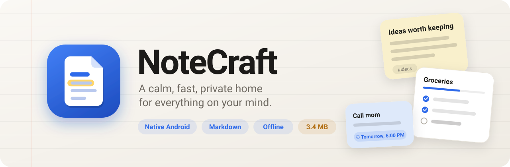
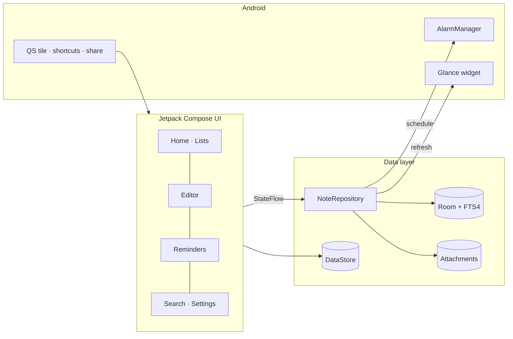

<div align="center">



<br/>

[](#-download)
[](#-download)
[](#-under-the-hood)
[](#-under-the-hood)
<br/>
[](#-why-v3)
[](#-privacy-first)
[](#-license)

**[Download](#-download)** · **[Features](#-features)** · **[Why v3](#-why-v3)** · **[Upgrading](#-upgrading-from-v2)** · **[Build](#-build-from-source)**

</div>

<br/>

> **NoteCraft** is a notes app that feels like paper and works like software. You open it and start typing, and it saves as you go.
> It's built natively for Android in Kotlin and Jetpack Compose, it's tiny, it works fully offline, and it doesn't ask for an account.

<!--
  📸 Screenshots: drop PNGs into docs/screenshots/ and uncomment this block.

<div align="center">
  
  
  
  
</div>
-->

## 📥 Download

<table>
<tr>
<td>

**[⬇️ NoteCraft-v3.0.0.apk](./NoteCraft-v3.0.0.apk)** (3.4 MB, works on any Android 8.0+ device)

Already using NoteCraft 2.x? Install v3 over it. Your notes, lists and reminders come with you automatically ([details](#-upgrading-from-v2)).

</td>
</tr>
</table>

## ✨ Features

<table>
<tr>
<td width="50%" valign="top">

### ✍️ Write naturally
- **Live Markdown.** Bold, italic, headings and highlights render *as you type*. The syntax fades into the background, so your notes stay plain text you can take anywhere.
- **A toolbar above the keyboard** for checklists, headings, lists, links, code and dividers, with undo and redo.
- **Smart lists.** Enter continues a bullet, number or checkbox; Enter on an empty item ends the list.
- **Reading mode** with tappable checkboxes and clickable links.
- **Images** you can pinch to zoom.
- **Version history.** Every editing session leaves a snapshot you can restore.

</td>
<td width="50%" valign="top">

### 🔗 Connect your thinking
- **`[[Note links]]`** with as-you-type suggestions. Tap a link to jump, or to create the note if it doesn't exist yet.
- **Backlinks** show which notes point to the one you're reading.
- **`#hashtags`** anywhere become filter chips on the home screen. Nested tags like `#work/q4` work too.
- **Full-text search** with highlighted snippets, recent searches and tag browsing.

</td>
</tr>
<tr>
<td valign="top">

### ☑️ Checklists that keep up
- **Fast entry:** Enter adds the next item, Backspace on an empty item removes it.
- **Paste a list** and every line becomes its own item.
- **Drag to reorder**, with auto-scroll near the edges.
- Checked items drop into a collapsible **Completed** section.
- Progress bar, check all, uncheck all, and clear completed with undo.
- Turn any note into a checklist and back.

</td>
<td valign="top">

### ⏰ Reminders in plain words
- Type it the way you'd say it. NoteCraft works out the date, time and repeat ([examples](#-type-it-like-youd-say-it)).
- Repeat daily, on weekdays, weekly, monthly or yearly.
- Notifications have **Done** and **Snooze** buttons. Snoozing a repeating reminder leaves the series on schedule.
- Attach reminders to notes and lists.
- Exact alarms that survive reboots.

</td>
</tr>
<tr>
<td valign="top">

### 🎨 Calm by design
- A warm paper palette in light, dark and **true-black AMOLED**.
- 9 note colours, 6 accent colours, and optional **Material You**.
- Sans, serif or mono editor fonts at the size you like.
- Grid or list layout, pinned notes, swipe to pin or trash, and long-press multi-select.
- Card-to-editor transitions, predictive back and subtle haptics.

</td>
<td valign="top">

### 📱 Everywhere on your phone
- A **home-screen widget** with pinned and recent notes.
- A **Quick Settings tile** for a new note.
- **Launcher shortcuts:** new note, list, reminder, search.
- **Share into NoteCraft** from any app, text or images.
- **"Save to NoteCraft"** in the text-selection menu of any app.

</td>
</tr>
</table>

### 🔒 Privacy first

| | |
|---|---|
| **No Internet permission** | NoteCraft *can't* send your data anywhere, and there's nothing to opt out of. |
| **App lock** | Fingerprint, face or device PIN, with a relock timer you choose. |
| **Locked notes** | Locked notes are hidden from cards, search snippets and the widget. |
| **Hide in recents** | Blocks screenshots and blanks the app switcher preview. |
| **Your data, your files** | One-file `.zip` backup and restore, Markdown export, and `.md`/`.txt` import. Restoring adds to what you have and never overwrites it. |

### 💬 Type it like you'd say it

| You type | NoteCraft schedules |
|---|---|
| `Call mom tomorrow at 6pm` | **Call mom** · tomorrow, 6:00 PM |
| `Standup every weekday 9:30` | **Standup** · 9:30 AM, repeats on weekdays |
| `Pay rent on 1 dec` | **Pay rent** · 1 Dec, 9:00 AM |
| `Stretch in 20 min` | **Stretch** · 20 minutes from now |
| `Water the plants every sunday 8am` | **Water the plants** · Sundays, 8:00 AM, weekly |
| `Take out the trash tonight` | **Take out the trash** · today, 8:00 PM |

<details>
<summary><b>📝 Markdown cheat sheet</b></summary>

<br/>

| Type this | Get this |
|---|---|
| `# Heading` · `## Smaller` | Headings (or tap **H** to cycle through levels) |
| `**bold**` · `*italic*` · `~~strike~~` | **bold** · *italic* · ~~strike~~ |
| `==highlight==` | A highlighter-pen mark |
| `- [ ] task` · `- [x] done` | Tappable checkboxes |
| `- item` · `1. item` | Lists that continue when you press Enter |
| `> quote` | A quote with an accent bar |
| `` `code` `` · ` ``` ` | Inline code and code blocks |
| `[text](https://…)` · `[[Note]]` | A web link · a link to another note |
| `#tag` · `#tag/sub` | Tags that become filters |
| `---` | Divider |

</details>

## 🚀 Why v3

NoteCraft 3 is a **ground-up native rewrite** of the original React Native app.

| | v2.1 · React Native | **v3.0 · Native** |
|---|:---:|:---:|
| APK size | 29 MB (arm64) · 86 MB (universal) | **3.4 MB universal** |
| Editor | WebView rich-text editor | **Native live-Markdown editor** |
| Search | `LIKE` scan | **SQLite FTS4 full-text index** |
| Dark mode | — | **Light · dark · AMOLED · Material You** |
| Reminders | One-off | **Natural language, repeats, snooze, survive reboots** |
| Delete | Immediate | **Undo, plus a 30-day trash** |
| Organisation | 4 fixed colour tags | **Hashtags, links, 9 colours, pin, archive** |
| Security | — | **App lock and per-note lock** |
| Widget · tile · shortcuts · share | — | **✓** |
| Backup | — | **Zip backup, Markdown export and import** |

## 🔄 Upgrading from v2

v3 uses the same package name as v2.1.1 and, in this build, the same signing key, so Android treats it as an **update**:

1. Install `NoteCraft-v3.0.0.apk` over the old app.
2. Open it. On first launch NoteCraft imports your old data:
   - **notes**: rich text is converted to Markdown, and old colour tags become note colours plus `#tags`
   - **checklists** and all of their items
   - **reminders**: upcoming ones are scheduled again
3. Done. The old database is kept as `*.migrated` and is never deleted.

## 🧩 Under the hood



| Layer | Choice | Why |
|---|---|---|
| Language | Kotlin 2.1 | Modern, concise, null-safe |
| UI | Jetpack Compose · Material 3 | Native rendering, shared-element transitions |
| Storage | Room + FTS4 with the `unicode61` tokenizer | Instant search in any language |
| Preferences | DataStore | Async and type-safe |
| Widget | Glance | A Compose-style home-screen widget |
| Security | BiometricPrompt | Fingerprint, face or device credential |
| Shrinking | R8 full mode + resource shrinking | The whole app fits in 3.4 MB |

It deliberately skips WebViews, image-loading libraries and DI frameworks. The Markdown engine, natural-language date parser and image cache are all small and written for this app.

<details>
<summary><b>📁 Project structure</b></summary>

```
app/src/main/java/com/notecraft/app
├── NoteCraftApp.kt        App, DI container, startup tasks, app-lock state
├── MainActivity.kt        Single activity: deep links, share, shortcuts, biometrics
├── data/
│   ├── db/                Entities, DAOs, Room database (+ FTS4 index)
│   ├── NoteRepository.kt  Single source of truth
│   ├── SettingsStore.kt   DataStore preferences
│   ├── AttachmentStore.kt Image import, downscaling, thumbnail cache
│   ├── BackupManager.kt   Zip backup/restore, Markdown export/import
│   └── LegacyMigrator.kt  One-time import from v2
├── domain/                NaturalDate parser, text tools (tags, previews, HTML→MD)
├── reminders/             Alarm scheduling, notifications, reboot handling
├── widget/ · tile/        Home-screen widget, Quick Settings tile
└── ui/                    theme · home · editor · lists · reminders · search · settings
```

</details>

## 🛠 Build from source

**Requirements:** JDK 17 and the Android SDK (platform 35).

```bash
git clone https://github.com/sharmaram25/Note-Craft.git
cd Note-Craft
./gradlew assembleRelease      # → app/build/outputs/apk/release/app-release.apk
./gradlew testDebugUnitTest    # unit tests
```

<details>
<summary><b>🔑 Release signing</b></summary>

<br/>

To sign with your own key, create `keystore.properties` in the project root:

```properties
storeFile=path/to/your.jks
storePassword=…
keyAlias=…
keyPassword=…
```

Without that file, the build falls back to `keystore/legacy-upgrade.keystore`. That's the public React Native template key that signed v2.x, and it's what makes the in-place upgrade work.
**Don't publish to the Play Store with it.** Switch to your own key once your users are on v3; switching keys means the next update has to be a fresh install.

</details>

## 📄 License

MIT. Use it, learn from it, make it yours.

<br/>

<div align="center">

**Crafted with care by [Ram Sharma](https://github.com/sharmaram25)**

<sub>If NoteCraft earns a spot on your home screen, a ⭐ helps others find it.</sub>

</div>
